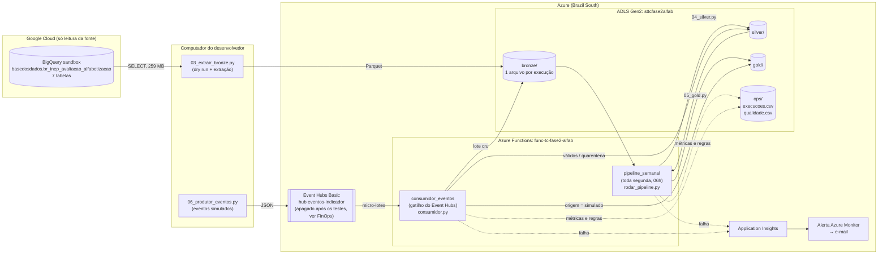

# Pipeline Híbrido para Análise da Alfabetização no Brasil — Tech Challenge Fase 2

Pipeline de dados na Azure que junta as seis tabelas do dataset `br_inep_avaliacao_alfabetizacao`, da Base dos Dados, em três camadas: Bronze, Silver e Gold. Os dados chegam por carga batch e por streaming. A pipeline tem regras de qualidade, registro de cada execução, alerta de falha por e-mail e uma estimativa de custo feita com números medidos.

**Vídeo executivo:** _(link a inserir)_

---

## 1. Contexto do problema

O Compromisso Nacional Criança Alfabetizada busca garantir que as crianças brasileiras estejam alfabetizadas até o fim do 2º ano do ensino fundamental. A partir da Pesquisa Alfabetiza Brasil (Inep, 2023), uma criança é considerada alfabetizada quando atinge **743 pontos** na escala do Saeb. O **Indicador Criança Alfabetizada** é o percentual de estudantes que alcança esse patamar.

Para acompanhar esse indicador é preciso juntar fontes diferentes: o microdado de cada aluno, os resultados por município e por UF e as metas nacionais, estaduais e municipais. Nenhuma dessas tabelas, sozinha, mostra quem está atingindo a meta pactuada, quem não está e quanto falta para 2030.

Sobre a meta de 2030, o projeto usa duas leituras:
- **Meta pactuada (usada em todas as comparações):** a trajetória publicada na fonte, ano a ano, de 2024 a 2030. Para a rede pública, a meta de 2030 é **80%**. A coluna `distancia_meta_2030` usa essa meta.
- **Universalização (cenário aspiracional):** 100% alfabetizados. Aparece apenas na coluna `distancia_universalizacao_cenario`, identificada como cenário.

Resultados atuais da rede pública no Brasil (tabela `gold/indicador_uf_brasil`):

| Ano | Taxa de alfabetização | Meta do ano (pactuada) | Situação | Distância até a meta de 2030 |
|---|---|---|---|---|
| 2023 | 55,9% | — (trajetória começa em 2024) | sem meta | 24,1 pp |
| 2024 | 59,2% | 59,9% | não atingiu | 20,8 pp |
| 2025 | 66,0% | 64,0% | atingiu | 14,0 pp |

Na rede municipal em 2024, **2.788 municípios atingiram** a meta do ano, **2.444 não atingiram** e **216 não têm meta cadastrada** (tabela `gold/indicador_municipio`).

---

## 2. Arquitetura proposta

O diagrama mostra o que está implementado e foi executado.



### Fluxo batch

1. **Extração (Bronze):** `src/03_extrair_bronze.py` mede o custo de cada leitura com dry run, lê as 7 tabelas do BigQuery e grava em Parquet em `bronze/<tabela>/dt_ingestao=AAAA-MM-DD/<id_execucao>.parquet`.
2. **Silver:** `src/04_silver.py` lê a execução mais recente da Bronze, traduz os códigos pela tabela `dicionario`, converte a rede das metas para código, desempilha as metas por ano, integra resultado com meta e roda todas as regras de qualidade **antes** de gravar.
3. **Gold:** `src/05_gold.py` gera os indicadores, a comparação com a meta, a evolução temporal, a validação cruzada com o microdado e a base para a Fase 3.
4. **Orquestração:** a Function `pipeline_semanal` roda toda segunda-feira às 06h (horário de Brasília) e chama `src/rodar_pipeline.py`, que executa Silver e Gold em sequência, cada uma em um processo separado. Se uma etapa falha, a falha é registrada e as etapas seguintes não rodam.

### Fluxo streaming

1. `src/06_produtor_eventos.py` publica eventos de "atualização do indicador de um município" no Event Hubs. Ele envia alguns **duplicados** (reenvio) e alguns **inválidos** de propósito.
2. A Function `consumidor_eventos` é acionada pelo Event Hubs e processa cada micro-lote com `src/consumidor.py`:
   - carimba o momento de ingestão e mede a **latência** (`momento_ingestao − momento_evento`);
   - grava o lote cru em `bronze/eventos/`;
   - manda os inválidos para `silver/eventos_quarentena/`;
   - descarta duplicados pelo `id_evento`, comparando com tudo o que já foi processado em `silver/eventos/`;
   - acrescenta os válidos em `gold/indicador_municipio` com **`origem = "simulado"`**.

### Tabelas por camada

| Camada | Tabelas | Política de escrita |
|---|---|---|
| Bronze | `alunos`, `municipio`, `uf`, `meta_alfabetizacao_brasil`, `meta_alfabetizacao_uf`, `meta_alfabetizacao_municipio`, `dicionario`, `eventos` | **Acumula.** Cada execução grava um arquivo novo com nome único; nenhuma execução apaga a anterior |
| Silver | `alunos`, `municipio`, `uf`, `meta_brasil`, `meta_uf`, `meta_municipio` (metas em formato longo), `municipio_meta`, `uf_meta` (resultado × meta), `eventos`, `eventos_quarentena` | Sobrescrita a cada execução, porque pode ser recriada a partir da Bronze. Os eventos acumulam |
| Gold | `indicador_municipio`, `indicador_uf_brasil`, `evolucao_temporal`, `validacao_cruzada`, `base_fase3` | Sobrescrita a cada execução, **preservando as linhas `origem = "simulado"`** vindas do streaming |
| ops | `execucoes.csv`, `qualidade.csv` | Acumula: uma linha nova por etapa ou regra |

---

## 3. Tecnologias utilizadas

| Tecnologia | Uso | Por que |
|---|---|---|
| Python 3.12 + pandas | Todas as transformações | O volume total é de cerca de 0,27 GB. pandas resolve com folga, sem custo nem complexidade de um cluster Spark |
| Parquet (pyarrow) | Formato de todas as camadas | Colunar e comprimido: a Bronze ocupa 69 MB por extração contra 259 MB lidos na fonte (−73%) |
| Google BigQuery (sandbox) | Forma de acesso à fonte | É onde a Base dos Dados publica as tabelas. O sandbox é gratuito e sem cartão |
| Azure Data Lake Storage Gen2 | Bronze, Silver, Gold e ops | Object storage com pastas reais; separa armazenamento de processamento |
| Azure Functions (Flex Consumption) | Execução na nuvem: batch agendado e consumidor de streaming | Serverless: paga só pelos segundos de execução, com cota gratuita mensal |
| Azure Event Hubs (Basic) | Mensageria do streaming | Serviço gerenciado equivalente ao Kafka (tópico, partição, offset, consumer group) |
| Application Insights + Azure Monitor | Registro de falhas e alerta por e-mail | Nativos da Azure, ligados às Functions sem código extra |

**Implementado:** tudo o que está na seção 2 foi executado na Azure. As evidências estão em `evidencias/`.

**Evolução futura (não implementado):**
- extração do BigQuery rodando dentro da Azure (seção 8);
- infraestrutura como código (Bicep ou Terraform) no lugar dos comandos da seção "Como reproduzir";
- testes automatizados das funções de transformação;
- troca do Event Hubs por uma fila do Storage (seção 5, FinOps).

---

## 4. Decisões arquiteturais

### Forma de acesso à fonte: BigQuery

O site da Base dos Dados limita o download direto de tabelas grandes, e a `alunos` tem 3,9 milhões de linhas. Por isso a leitura é feita pelo BigQuery, no modo **sandbox** (gratuito, sem cartão).

- **Por que esse caminho:** é a forma oficial de acesso à tabela completa, e o custo pode ser medido antes de ler, com dry run.
- **Custo:** a leitura completa das 7 tabelas processa **259 MB**, o que equivale a **0,025% da cota gratuita mensal** de 1 TiB. Só a `alunos` responde por 99% desse volume.
- **Transferência entre nuvens:** os 259 MB lidos saem do Google pela API e entram na Azure como 69 MB de Parquet. A entrada de dados na Azure não é cobrada. No Google, o sandbox não gera cobrança.
- **Quando a fonte for atualizada:** basta rodar `src/03_extrair_bronze.py` de novo. Ele grava uma nova versão na Bronze sem apagar a anterior, e a Silver passa a usar a versão mais recente.

### Duas nuvens

O projeto usa o Google apenas para **ler a fonte** e a Azure para **todo o resto**. Mesmo com o papel do Google sendo pequeno, isso traz os custos que o enunciado aponta:
- **Dois modelos de acesso:** login do Google (`gcloud`) para a extração e chave de acesso da Azure para o resto.
- **Duas contas para acompanhar:** o sandbox do Google (sem cobrança) e o crédito de estudante da Azure.
- **Duas ferramentas para dominar:** BigQuery e o ecossistema Azure.
- **Transferência de saída:** pequena, porque a leitura é de 259 MB e só acontece quando a fonte é atualizada.
- **Duplicação de armazenamento:** o dado existe na Base dos Dados (que não pertence ao projeto e não gera custo de armazenamento para ele) e na Bronze da Azure. A cópia é proposital: é ela que guarda o histórico de versões que a fonte não guarda.

A Azure foi escolhida para o processamento porque é a nuvem disponível sem cartão, pelo programa Azure for Students. Mover a fonte para a Azure exigiria baixar e subir os mesmos dados, sem ganho.

### Batch × streaming

| | Batch | Streaming |
|---|---|---|
| Frequência | 1 vez por semana (Silver e Gold) e quando a fonte é atualizada (extração) | A cada evento recebido |
| Latência medida | Execução completa na nuvem: Silver em 8,4 s e Gold em 5,4 s; extração em cerca de 13 min | Do produtor até a gravação: **~2,2 s em média** (evidencias/03) |
| Garantia de entrega | Leitura completa da fonte a cada execução | Event Hubs entrega **pelo menos uma vez**: pode repetir mensagens. O consumidor é **idempotente**: descarta duplicados pelo `id_evento` |
| Processamento | Tabela inteira | Micro-lotes de até 10 eventos |

O indicador oficial muda poucas vezes por ano, então o batch é o caminho principal. Por isso Silver e Gold rodam uma vez por semana, e não todo dia: uma atualização da fonte chega à Gold em até 7 dias, sem reprocessar o mesmo dado sem necessidade. O agendamento fica ativo até 02/02/2027, data definida na configuração `DATA_FIM_AGENDAMENTO` da Function. Depois disso a Function continua existindo, mas não processa mais nada. O streaming serve para atualizações pontuais, que ficam separadas do dado oficial pela coluna `origem`.

### Data Lake × Data Warehouse

Todas as camadas são arquivos Parquet no ADLS Gen2 (data lake), sem um data warehouse. Com 0,27 GB, um warehouse pago (Synapse dedicado, por exemplo) seria custo sem necessidade. Os arquivos da Gold podem ser lidos diretamente por pandas, Power BI ou um modelo de ML.

### Custo × performance

- **pandas em vez de Spark:** o volume não justifica um cluster.
- **Function com 4 GB de memória e uma etapa por processo:** a primeira execução na Azure, com Silver e Gold no mesmo processo, esgotou a memória (seção 7).
- **Processamento na mesma região dos dados (Brazil South):** a Silver levou 8,4 s na nuvem contra minutos rodando no computador, sem custo de transferência.

### Regra para comparar resultado e meta

A trajetória de metas muda conforme o ano da avaliação. A regra adotada foi: **o resultado do ano X é comparado com a meta para o ano X da edição publicada no próprio ano X**. Como a trajetória começa em 2024, 2023 fica como **"sem meta"**. A comparação só é feita entre o mesmo recorte de rede e série.

---

## 5. Qualidade de dados, monitoramento e FinOps

### Regras de qualidade

As regras ficam em `src/04_silver.py`, `src/05_gold.py` e `src/consumidor.py`. A função `checar_regra` (em `src/utils_pipeline.py`) grava cada resultado em `ops/qualidade.csv`. Quando uma regra **bloqueante** falha, o script para **antes de gravar a camada seguinte**. O erro não é capturado e ignorado: ele sobe até a Function, que fica marcada como falha e dispara o alerta.

| Regra | Tipo | Resultado medido |
|---|---|---|
| Chaves sem nulo (alunos, município, UF) | bloqueante | 0 nulos |
| Sem duplicidade de chave (município, UF, aluno por ano) | bloqueante | 0 duplicados |
| Todo código traduzido pelo `dicionario` (nenhum "desconhecido") | bloqueante | 0 desconhecidos |
| Rede das metas convertida para código | bloqueante | 0 desconhecidos |
| `id_municipio` com código de UF válido | bloqueante | 0 sem UF |
| Municípios dos alunos existem na tabela `municipio` (≥ 99%) | bloqueante | 99,98% |
| **Taxa de match meta municipal × município (≥ 95%)** | bloqueante | **99,53%** |
| **Taxa de match meta UF × UF (≥ 85%)** | bloqueante | **90,74%** |
| Gold: município × meta municipal (≥ 95%) | bloqueante | 97,78% |
| Gold: taxa × metas de UF e Brasil (≥ 95%) | bloqueante | 97,62% |
| Gold: microdado × taxa oficial (≥ 85%) | bloqueante | 98,62% |
| Gold: município × perfil dos alunos (≥ 95%) | bloqueante | 96,60% |
| Gold: base da Fase 3 × resultado do ano anterior | informativa | 94,15% (anos com histórico) |
| Base da Fase 3 sem colunas derivadas do alvo | bloqueante | ok |
| Situação da meta só com estados previstos | bloqueante | ok |
| Taxa da tabela de meta = taxa do resultado | informativa | diferença média 0,017 |
| 27 UFs presentes na rede pública | informativa | faltam 3 (2023) e 2 (2024) |
| `nivel_alfabetizacao` preenchido | informativa | 120 nulos |
| Alunos da rede privada | informativa | 25 alunos |
| Validação cruzada microdado × oficial | informativa | ver seção 6 |
| Eventos inválidos ou duplicados no lote | informativa | registrados por lote |

Toda junção entre tabelas tem a taxa de correspondência medida logo depois, porque um join sem par não dá erro: ele gera nulo.

O limiar da taxa de match foi definido a partir da taxa observada na primeira execução (99,5% para município e 90,7% para UF), com margem. Uma queda abaixo dele indica mudança estrutural na fonte, como um código ou formato de chave diferente, e não variação normal. O limiar da UF é menor porque a própria fonte não publica algumas UFs, o que é registrado à parte como regra informativa.

A correspondência entre as redes foi conferida com os dados. As tabelas de meta escrevem a rede por extenso ("Pública", "Municipal"), enquanto as de resultado usam código. `src/02_investigar_metas.py` compara a taxa que as duas tabelas trazem: "Pública" coincide com o código 5 (diferença média 0,005) e "Municipal" com o código 3 (0,017). Um join direto entre texto e código não casaria nenhuma linha e não daria erro, só nulos.

Para demonstrar a falha existe a configuração `SIMULAR_FALHA=1`. Com ela, a Silver recebe a rede da meta municipal em maiúsculas, como se a fonte tivesse mudado o formato de uma chave. A regra bloqueante falha (10.704 códigos desconhecidos), o script termina com erro e a Silver não é regravada. Isso foi executado no computador (`evidencias/01_falha_regra_bloqueante.txt` e `evidencias/02_qualidade_com_falha.csv`) e na Azure (registro de 20:23:13 em `evidencias/05_execucoes_com_nuvem.csv`).

### Monitoramento

- **Métricas persistidas:** cada etapa grava em `ops/execucoes.csv` data e hora, etapa, tabela, linhas de entrada e de saída, duração, status, bytes processados e detalhe (ID do job do BigQuery, latência do streaming). O arquivo acumula execuções.
- **Falhas de ingestão e de processamento:** a extração (`python src/rodar_pipeline.py extracao`) e as etapas Silver e Gold passam pelo `rodar_pipeline.py`, que grava a linha com status `falha` e a mensagem de erro e depois propaga o erro. No streaming, a falha de um lote marca a execução da Function como falha e dispara o alerta.
- **Latência:** no streaming, o produtor grava `momento_evento` e o consumidor grava `momento_ingestao`, cada um com o próprio relógio. A diferença média medida foi de 2,2 s.
- **Alerta:** a regra `alerta-falha-pipeline` do Azure Monitor verifica a cada 5 minutos se alguma execução das Functions falhou (`requests | where success == false`) e manda e-mail pelo grupo de ações `ag-tc-fase2-email`.

**Em produção, quem descobre que o pipeline quebrou, e em quanto tempo?** O responsável cadastrado no grupo de ações recebe um e-mail **em até cerca de 10 minutos** após a falha (5 minutos de janela da regra, mais o envio). Além do e-mail, a falha fica registrada em `ops/execucoes.csv` com a mensagem do erro. Durante o projeto ocorreram na Azure uma falha real (falta de memória, seção 7) e uma falha simulada, e o e-mail de alerta foi recebido.

### FinOps

**Práticas aplicadas:**
- Parquet com compressão (−73% em relação ao volume lido) e particionamento da Bronze por data de ingestão.
- Leitura só das colunas necessárias (a Gold lê apenas as 9 colunas de `alunos` que usa).
- Dry run antes de cada leitura no BigQuery.
- Processamento serverless, na mesma região dos dados.
- Tags `projeto` e `ambiente` em todos os recursos.
- Desligamento de recurso ocioso: o Event Hubs foi apagado ao fim dos testes (ver abaixo).

**Estimativa de custo.** As quantidades são medidas e os preços vêm da API pública da Azure (Brazil South) e do preço público do BigQuery. O cálculo está em `src/08_estimar_custos.py`, e a saída em `evidencias/09_estimativa_custos.txt`. O ambiente usado é gratuito (BigQuery sandbox e crédito Azure for Students), então a tabela **projeta o mesmo desenho pago**, com esta frequência: Silver e Gold uma vez por semana, 1 extração por mês e 10 mil eventos por mês (volume imaginado para o streaming).

| Serviço | Unidade | Quantidade medida | Preço unitário (US$) | Custo mensal projetado (US$) |
|---|---|---|---|---|
| BigQuery (leitura da fonte) | TiB lido | 0,000247 (259 MB por extração) | 6,25 | 0,00 (dentro de 1 TiB grátis) |
| ADLS Gen2 Hot LRS | GB/mês | 0,20 (Bronze 136,8 MB, Silver 72,1 MB, Gold 0,7 MB) | 0,033 | 0,01 |
| Azure Functions Flex | GB-segundo | 6.758 (22,4 s por execução semanal e 1,6 s por lote, com 4 GB) | 0,000037 | 0,00 (dentro de 100 mil GB-s grátis) |
| Event Hubs Basic (unidade ligada) | hora | 730 | 0,015 | 10,95 |
| Event Hubs Basic (eventos) | milhão de eventos | 0,01 | 0,028 | 0,00 |
| **Total** | | | | **≈ 10,96** |

Quase todo o custo vem do Event Hubs ligado 24 horas por dia. O processamento da pipeline custa **US$ 0,003 por execução**. Para o volume de 10 mil eventos por mês, a recomendação é trocar o Event Hubs por uma fila do próprio Storage (cobrada por operação) ou mantê-lo ligado só durante a janela de atualização. Por isso o namespace do Event Hubs foi **apagado** depois dos testes, e a Function de streaming foi desligada (`AzureWebJobs.consumidor_eventos.Disabled=true`). Os comandos para recriar estão em "Como reproduzir".

---

## 6. Aplicação em IA

A tabela `gold/base_fase3` foi preparada para o modelo preditivo da Fase 3: **uma linha por município × ano × rede** (redes estadual, municipal e pública), com 23.597 linhas.

- **Alvo:** `taxa_alfabetizacao`.
- **Variáveis:** `sigla_uf`, `rede`, `alunos_previstos`, `escolas`, `percentual_presenca`, `taxa_ano_anterior` e `media_portugues_ano_anterior`.

**Cuidado com vazamento de alvo.** Ficaram fora da base:
- `media_portugues` e `proporcao_aluno_nivel_*` do mesmo ano, porque são calculadas a partir das mesmas notas que geram o alvo;
- a taxa que vem nas tabelas de meta, que é o próprio alvo;
- `nivel_alfabetizacao`, cuja forma de cálculo não está documentada na fonte.

Só entram informações que já existiam antes do resultado ser publicado: participação, tamanho e o resultado do ano anterior. Uma regra bloqueante em `05_gold.py` impede que essas colunas voltem para a base.

**Usos possíveis:**
- **Predição de alfabetização:** estimar a taxa do próximo ano por município, para priorizar apoio antes do resultado.
- **Desigualdade educacional:** comparar municípios e UFs pela distância até a meta pactuada (`gold/indicador_municipio` e `gold/indicador_uf_brasil`).
- **Políticas públicas baseadas em dados:** identificar os municípios que não atingiram a meta e acompanhar a evolução (`gold/evolucao_temporal`).

**Limitações para o modelo:**
- Com só 2 anos de resultado municipal (2023 e 2024), `taxa_ano_anterior` está vazia em 52% das linhas, a maior parte delas de 2023, que não tem ano anterior.
- 3,4% das linhas não têm perfil de alunos.
- Qualquer projeção até 2030 com 2 ou 3 pontos é um **cenário**, não uma previsão.

---

## 7. Validação cruzada e investigação de anomalias

**Validação cruzada (microdado × indicador oficial).** A partir da `alunos`, a taxa foi recalculada só com os **alunos presentes**, ponderando pelo `peso_aluno`, e comparada com a taxa publicada (`gold/validacao_cruzada`):

| | Recalculada do microdado | Oficial | Diferença |
|---|---|---|---|
| Brasil 2024, rede pública | 59,20% | 59,2% | **0,00 pp** |
| UFs (média de todas as UFs e redes) | — | — | **0,03 pp** |
| Brasil 2023, rede pública | 57,46% | 55,9% | 1,56 pp |

Em 2024 os números batem exatamente, o que confirma o denominador (só presentes), o peso amostral e a tradução das redes. Os alunos ausentes aparecem na base com `alfabetizado = 0`. Se entrassem no denominador, a taxa seria puxada para baixo.

**Investigação 1, Brasil 2023.** As UFs batem em 2023, mas o total nacional não. A descrição oficial da coluna de taxa na tabela de meta nacional diz: *"considerados, mediante o resultado da avaliação estadual, como alfabetizados"*. A **hipótese** é que o número nacional de 2023 combinou resultados de avaliações estaduais que não estão no microdado do Saeb. A hipótese não foi confirmada com a fonte e está registrada como tal.

**Investigação 2, falta de memória na nuvem.** A primeira execução na Azure terminou com código 137 (memória esgotada): Silver e Gold rodavam no mesmo processo, e a Silver guardava traduções em texto para 3,9 milhões de linhas. A correção foi rodar cada etapa em um processo separado, guardar só as traduções necessárias e fazer a Gold ler apenas as colunas que usa.

**Investigação 3, batch apagando o streaming.** A Gold diária regravava `indicador_municipio` do zero e apagaria os eventos do streaming. A Gold passou a ler a versão anterior e manter as linhas com `origem = "simulado"`.

---

## 8. Limitações conhecidas

- **Extração fora da Azure:** a extração do BigQuery (`03_extrair_bronze.py`) roda no computador do desenvolvedor, porque depende do login do Google (`gcloud`). Executá-la na Azure exigiria uma chave de conta de serviço do Google, que não foi criada no sandbox. A fonte é atualizada no máximo algumas vezes por ano.
- **Lacunas da fonte:**
  - 3 UFs ausentes em 2023 e 2 em 2024 na tabela `uf`;
  - 120 municípios sem `nivel_alfabetizacao`, cujo significado não está documentado;
  - 25 alunos da rede privada;
  - 0,04% dos presentes sem nota;
  - 50 linhas de meta municipal sem resultado correspondente.
- **Metas sem série:** as tabelas de meta não têm a coluna `serie`. Como a fonte só traz o 2º ano, as metas foram consideradas do 2º ano.
- **Dado simulado:** os eventos do streaming são simulados e estão identificados por `origem = "simulado"` em `gold/indicador_municipio`. A deduplicação compara com todos os eventos já processados, o que é adequado para o volume do projeto, mas teria de ser trocada por uma chave indexada em volume maior.
- **Infraestrutura:** foi criada por comandos da Azure CLI (seção "Como reproduzir"), e não por infraestrutura como código.
- **Alerta de orçamento:** não foi criado por linha de comando (a API retornou erro para a assinatura de estudante). A assinatura Azure for Students para os serviços quando o crédito acaba.
- **Horários:** os registros usam o horário de Brasília. As linhas de `ops/execucoes.csv` com horário 22:58 e 23:03 de 02/11/2026 foram gravadas pela Azure em UTC, antes da padronização (equivalem a 19:58 e 20:03 em Brasília).

---

## Como reproduzir

### Pré-requisitos

- Python 3.12
- [Google Cloud CLI](https://cloud.google.com/sdk/docs/install) e um projeto no Google Cloud (o sandbox do BigQuery basta)
- [Azure CLI](https://learn.microsoft.com/cli/azure/install-azure-cli) e uma assinatura Azure
- [Azure Functions Core Tools](https://learn.microsoft.com/azure/azure-functions/functions-run-local) v4

### 1. Ambiente local

```bash
python -m venv .venv
.venv\Scripts\activate          # Windows
source .venv/bin/activate       # Linux/Mac
pip install -r requirements.txt

gcloud auth application-default login
gcloud auth application-default set-quota-project SEU_PROJETO_GCP
az login
```

Copie `.env.example` para `.env` e preencha os valores. Nenhum identificador fica fixo no código: todos são lidos do `.env` por `src/config.py`.

### 2. Infraestrutura na Azure

Os nomes abaixo são os usados no projeto. Troque o nome da conta de armazenamento e da Function, que precisam ser únicos.

```bash
az provider register --namespace Microsoft.Storage --wait
az provider register --namespace Microsoft.EventHub --wait
az provider register --namespace Microsoft.Web --wait
az provider register --namespace Microsoft.Insights --wait

az group create -n rg-tc-fase2 -l brazilsouth --tags projeto=tc-fase2 ambiente=dev

az storage account create -n sttcfase2alfab -g rg-tc-fase2 -l brazilsouth --sku Standard_LRS --kind StorageV2 --hns true --allow-blob-public-access false --tags projeto=tc-fase2 ambiente=dev
for c in bronze silver gold ops; do az storage container create --account-name sttcfase2alfab -n $c --auth-mode key; done

# streaming (o namespace cobra por hora: apague depois de usar)
az eventhubs namespace create -g rg-tc-fase2 -n evhns-tc-fase2-alfab -l brazilsouth --sku Basic
az eventhubs eventhub create -g rg-tc-fase2 --namespace-name evhns-tc-fase2-alfab -n eventos-indicador --partition-count 1 --retention-time 24 --cleanup-policy Delete
az eventhubs namespace authorization-rule keys list -g rg-tc-fase2 --namespace-name evhns-tc-fase2-alfab --authorization-rule-name RootManageSharedAccessKey --query primaryConnectionString -o tsv

# Function App (cria o Application Insights junto)
az functionapp create -g rg-tc-fase2 -n func-tc-fase2-alfab --storage-account sttcfase2alfab --flexconsumption-location brazilsouth --runtime python --runtime-version 3.12 --instance-memory 4096
az functionapp config appsettings set -g rg-tc-fase2 -n func-tc-fase2-alfab --settings AZURE_STORAGE_ACCOUNT=... AZURE_STORAGE_KEY=... EVENTHUB_CONNECTION_STRING=... EVENTHUB_NAME=eventos-indicador DATA_FIM_AGENDAMENTO=2027-02-02

# alerta de falha por e-mail
az monitor action-group create -g rg-tc-fase2 -n ag-tc-fase2-email --short-name alertatc --action email responsavel SEU_EMAIL
az monitor scheduled-query create -g rg-tc-fase2 -n alerta-falha-pipeline --scopes ID_DO_APPLICATION_INSIGHTS --condition "count 'Falhas' > 0" --condition-query Falhas="requests | where success == false" --evaluation-frequency 5m --window-size 5m --severity 1 --action-groups ID_DO_GRUPO_DE_ACOES
```

### 3. Executar a pipeline

Os scripts são executados a partir da raiz do projeto.

```bash
python src/01_explorar_fonte.py        # custo (dry run), schemas e dicionário
python src/02_investigar_metas.py      # correspondência das redes entre metas e resultados
python src/rodar_pipeline.py extracao  # extração -> Bronze (cerca de 13 min), registra falha se houver
python src/rodar_pipeline.py           # Silver -> Gold, para na primeira falha

# streaming: em um terminal o consumidor, em outro o produtor
python src/07_consumidor_eventos.py
python src/06_produtor_eventos.py

python src/08_estimar_custos.py        # tabela de custo
```

Para demonstrar a falha, acrescente `SIMULAR_FALHA=1` ao `.env` e rode `python src/04_silver.py`. Retire a linha depois.

### 4. Publicar na Azure

```bash
func azure functionapp publish func-tc-fase2-alfab --python
```

Isso publica as Functions `pipeline_semanal` (toda segunda-feira às 06h de Brasília) e `consumidor_eventos` (acionada pelo Event Hubs). Para religar o streaming depois de recriar o Event Hubs, remova a configuração `AzureWebJobs.consumidor_eventos.Disabled`.

---

## Estrutura do repositório

```
src/
  config.py                  configurações lidas do .env
  utils_pipeline.py          registro de execuções, regras de qualidade e situação da meta
  01_explorar_fonte.py       dry run, schemas e dicionário
  02_investigar_metas.py     prova da correspondência das redes
  03_extrair_bronze.py       extração BigQuery -> Bronze
  04_silver.py               Silver + regras de qualidade
  05_gold.py                 Gold + validação cruzada + base da Fase 3
  rodar_pipeline.py          Silver -> Gold em sequência, com registro de falha
  06_produtor_eventos.py     produtor do streaming
  consumidor.py              processamento de um micro-lote de eventos
  07_consumidor_eventos.py   consumidor do streaming para rodar localmente
  08_estimar_custos.py       estimativa de custo com quantidades medidas
function_app.py              Azure Functions (batch agendado e consumidor de eventos)
host.json                    configuração das Functions
evidencias/                  logs e registros das execuções
requirements.txt             dependências com versão
.env.example                 modelo das configurações
```

As camadas Bronze, Silver e Gold ficam nos containers `bronze/`, `silver/` e `gold/` da conta ADLS Gen2, e os registros de operação em `ops/`.

## Evidências de execução

| Arquivo | O que mostra |
|---|---|
| `evidencias/01_falha_regra_bloqueante.txt` | Silver parando em regra bloqueante (falha simulada) |
| `evidencias/02_qualidade_com_falha.csv` | Registro da regra que falhou |
| `evidencias/03_streaming_consumidor.txt` | Micro-lotes processados: válidos, inválidos, duplicados e latência |
| `evidencias/04_streaming_produtor.txt` | Eventos enviados, com duplicados e inválidos |
| `evidencias/05_execucoes_com_nuvem.csv` | Histórico de execuções: extrações com ID dos jobs do BigQuery, execuções na Azure e falhas |
| `evidencias/06_qualidade_com_nuvem.csv` | Histórico de todas as regras de qualidade |
| `evidencias/07_functions_na_azure.txt` | Functions publicadas na Azure |
| `evidencias/09_estimativa_custos.txt` | Saída do cálculo de custo |
| `evidencias/10_execucoes_functions_azure.csv` | Execuções das Functions na Azure, com ID, duração e sucesso ou falha (Application Insights, horário UTC) |
